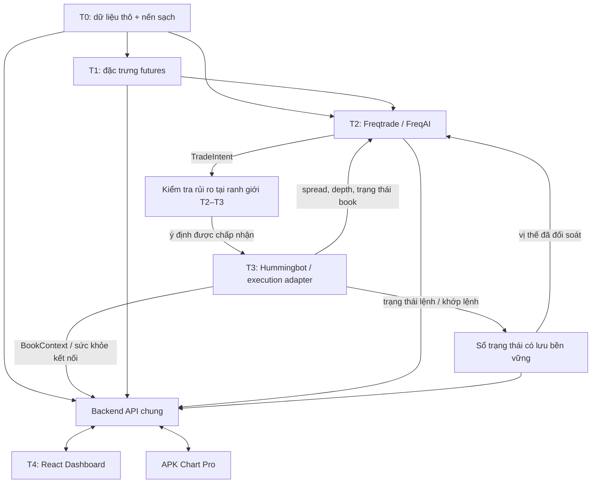

# Kiến trúc hệ thống 5 tầng

Ngày rà soát: 2026-10-29. Trạng thái: **thiết kế đích và lựa chọn nguồn**, chưa phải hệ thống đã triển khai. Giữ APK Chart Pro làm một client; React Dashboard là client thứ hai của cùng backend. Giai đoạn đầu dùng Binance USDⓈ-M, BTCUSDT và paper trading, theo phạm vi hiện tại của dự án.

## 1. Chọn thành phần theo nhiệm vụ

| Tầng | Thành phần được chọn | Trách nhiệm | Phần cần bổ sung |
| --- | --- | --- | --- |
| 0 — Kho dữ liệu | Collector của [waynemason1/binance-futures-collector](https://github.com/waynemason1/binance-futures-collector/tree/bc4f0ef633fbeee4a49defd72827f17162693805) + [Freqtrade download-data](https://github.com/freqtrade/freqtrade/blob/develop/docs/data-download.md)/CCXT | Thu thập futures live; lưu dữ liệu thô CSV và nến 1m đã đóng; kiểm tra capture offline; tải lịch sử phục vụ nghiên cứu | Adapter nhập dữ liệu, chuẩn hóa nến đã đóng M15/H1, API truy vấn và kho dữ liệu chuẩn. Đối chiếu OHLCV cùng nguồn trước khi ghép lịch sử và live |
| 1 — Trinh sát vi mô | Module Futures Intelligence của dự án, đọc các feed funding/OI/liquidation/trades từ collector | Tính taker buy/sell delta theo cửa sổ, biến động OI, funding context, giao dịch lớn và các sự kiện thanh lý quan sát được | Định nghĩa chỉ số, kiểm soát độ mới và bao phủ dữ liệu; module on-chain riêng khi có nguồn phù hợp |
| 2 — Chiến lược và AI | [Freqtrade + FreqAI](https://github.com/freqtrade/freqtrade) | Backtest, train/predict và đánh giá chiến lược; xuất `TradeIntent` | Adapter ra quyết định và nhận trạng thái vị thế; cổng rủi ro trước thực thi |
| 3 — Sổ lệnh và thực thi | [Hummingbot](https://github.com/hummingbot/hummingbot) + [Hummingbot API](https://github.com/hummingbot/hummingbot-api) | Đọc sổ lệnh, kiểm tra thanh khoản; chủ sở hữu duy nhất của lệnh khi có thực thi | Execution adapter, mô phỏng khớp lệnh, đối soát và kiểm thử khớp một phần/hủy/thay lệnh |
| 4 — Trung tâm điều khiển | Mở rộng **Capture Desk React/TypeScript** trong repo collector; giữ APK Android hiện tại | Hiển thị dữ liệu, chất lượng feed, chiến lược/model, vị thế và trạng thái lệnh; gửi yêu cầu điều khiển qua backend | API chung có xác thực/phân quyền; giao diện chiến lược, paper orders, PnL và nhật ký thao tác |

Năm tầng là năm trách nhiệm logic, không bắt buộc năm repo hoặc năm dịch vụ độc lập. Tầng 0 và giao diện tầng 4 có thể tận dụng cùng repo collector. Chưa cần event bus hoặc một framework điều phối mới cho MVP.

Chọn collector vì phạm vi này cần cả trades, funding, OI và liquidation ở tầng 1. Nếu chỉ triển khai nến M15/H1 trước, dùng Freqtrade/CCXT và API mỏng trong repo hiện tại, chưa cần chạy collector Rust. Chỉ bật capture cho BTCUSDT khi bước trinh sát cần các feed này.

### Vì sao không ghép nguyên các repo theo tên

- Bốn repo cùng tên `Bitcoin-Price-Analysis-API` đã kiểm tra có phần chức năng giống nhau: lưu OHLCV ngày từ Yahoo Finance, model lấy `date` làm khóa; endpoint giá hiện tại đọc spot ticker. Chưa có bộ thu thập futures M15/H1 đúng nhu cầu. File LICENSE trong các bản đã kiểm tra rỗng, dù README ghi MIT. Không chọn làm lõi tầng 0.
- [Crypto Futures AI Trading Bot](https://github.com/aitradingbotspro/crypto-futures-ai-trading-bot) có funding và basis; `LiquidationBot` phân tích Aave/DeFi, không phải luồng thanh lý hợp đồng Binance. `WhaleAlertMonitor.getRecentLargeTransfers()` chưa triển khai lấy dữ liệu. Chưa tìm thấy file LICENSE ở repo này qua API. Chỉ tham khảo kiến trúc; chưa đưa mã vào sản phẩm.
- Capture Desk có React 18/TypeScript/Vite và LICENSE MIT thực tế. Các tab hiện tại phục vụ capture, coverage, validation, replay, export, config và logs; chưa phải terminal quản lý chiến lược/lệnh. Backend hiện không có xác thực và có endpoint sửa config/restart; chỉ đưa ra ngoài qua backend/proxy có xác thực. Repo được tác giả công bố dưới dạng không cam kết bảo trì; pin commit và kiểm thử phần dùng lại.
- Collector lưu CSV append-only, **không phải database/API nến chuẩn sẵn có**. Không khẳng định nó đã hoàn thành tầng 0 hoặc tầng 4 của hệ thống mới.
- Kiểm tra mã `orderbook_manager.rs` tại commit đã pin cho thấy collector không buộc `pu == last_update_id` hoặc resnapshot khi reconnect. Sổ lệnh capture có thể dùng cho nghiên cứu với nhãn chất lượng; không dùng trạng thái live book này làm chứng nhận đồng bộ cho execution. Bộ kiểm tra offline và trạng thái đồng bộ live là hai tính chất khác nhau.

## 2. Luồng dữ liệu và quyền sở hữu

FreqAI là thành phần học máy trong Freqtrade, không phải bộ thực thi độc lập. Freqtrade thông thường tự quản lý lệnh/vị thế. Nếu chọn Hummingbot làm executor, cần adapter xuất ý định chiến lược và đưa kết quả khớp/vị thế trở lại vòng đánh giá; không chạy hai bộ máy cùng gửi lệnh cho cùng chiến lược/tài khoản.

`dry_run` của Freqtrade là mô phỏng của Freqtrade, không tự trở thành cầu nối thực thi sang Hummingbot. Trước khi có adapter nhận fill đúng, kết quả nghiên cứu được giữ ở chế độ shadow/research; không đồng nhất vị thế giả lập của Freqtrade với vị thế của executor.

Kho lệnh/vị thế ở server là nguồn trạng thái chung. React và APK đọc cùng trạng thái, không tự tính một vị thế độc lập rồi coi đó là lệnh đã khớp. Kho này lưu event ID, mã lệnh sàn, lượng đã khớp, lượng còn lại và phí; đối soát với executor sau khởi động lại.

## 3. Hợp đồng tối thiểu

Các hợp đồng dưới đây mô tả thiết kế đích. `/v1/order-book` và API nến `/v1/candles` đã có mã nguồn; các hợp đồng trinh sát/chiến lược/thực thi/điều khiển vẫn là đề xuất.

| Hợp đồng | Trường bắt buộc / quy tắc |
| --- | --- |
| `Candle` | `exchange`, `marketType`, `symbol`, `timeframe`, `openTimeMs`, `closeTimeMs`, OHLCV, `isClosed`, `availableAtMs`, `quality`, `datasetVersion` |
| `MicroFeature` | Thị trường/cặp, `featureName`, giá trị hoặc null, đơn vị, `windowStartMs`, `windowEndMs`, `availableAtMs`, `source`, `quality`, `coverage` |
| `BookContext` | Thị trường/cặp, bid/ask, spread/depth, `observedAtMs`, `exchangeEventAtMs` nếu có, update ID và `sequenceVerified`. Không suy ra sequence từ thời điểm nhận HTTP |
| `TradeIntent` | `intentId`, `strategyVersion`, `modelVersion` hoặc null, `datasetVersion`, thị trường/cặp, `action`, `targetPositionBase`, `decisionAtMs`, `validUntilMs`, tham chiếu dữ liệu đầu vào |
| `ExecutionEvent` | `eventId`, `intentId`, `clientOrderId`, `exchangeOrderId` nếu có, trạng thái, lượng khớp tích lũy/còn lại, giá/phí khớp và thời gian |
| `ControlCommand` | `commandId`, người gửi, loại thao tác, phạm vi chiến lược, thời gian, kết quả và nhật ký kiểm tra quyền |

- Định danh thị trường tách khỏi tên hiển thị: `binance` + `USDT_PERPETUAL` + `BTCUSDT`. Adapter ánh xạ sang `BTC-USDT` của Hummingbot hoặc `BTC/USDT:USDT` của CCXT/Freqtrade; không chỉ xóa dấu phân cách rồi ghép các thị trường.
- Giá/khối lượng/tiền dùng số thập phân chính xác hoặc chuỗi decimal tại biên API; thời gian UTC milliseconds. Ghi rõ đơn vị base asset, quote asset, contracts và rate; chuyển đổi theo metadata hợp đồng của sàn.
- Khóa duy nhất của nến là `(exchange, marketType, symbol, timeframe, openTimeMs)`. Kiểm tra OHLC, khối lượng và continuity; đánh dấu gap, không âm thầm điền giá/nến.
- Nến chưa đóng chỉ dùng cho hiển thị. Feature/model/entry dùng dữ liệu sẵn có đúng thời điểm quyết định. Backtest ghép theo `availableAtMs`; dữ liệu import lịch sử không có thời điểm khả dụng phải ghi rõ giới hạn, không bịa thời gian đã nhận.
- Funding, OI, taker delta và chuyển tiền on-chain giữ riêng. Funding không phải dòng tiền; chuyển ví không tự chứng minh mua/bán. Dữ liệu thiếu là null/unavailable, không thay bằng 0 hoặc mẫu giả.
- CVD phải nêu điểm reset, cửa sổ và khoảng mất dữ liệu. Tổng taker buy trừ taker sell trong 5 phút được ghi là delta 5 phút nếu chưa theo dõi CVD liên tục. Luồng liquidation quan sát được không mặc nhiên đại diện toàn bộ thanh lý của sàn.

## 4. Ranh giới thực thi

Cổng rủi ro ở backend kiểm tra: chế độ paper/disabled, quyền điều khiển, allowlist thị trường/cặp, thời hạn intent, chất lượng dữ liệu, trạng thái book, giới hạn vị thế/notional và lượng tối thiểu/bước giá của sàn. Các ngưỡng phải được cấu hình và ghi phiên bản; không lấy số ngẫu nhiên làm cấu hình giao dịch đã được duyệt.

Mỗi intent có ID ổn định qua mọi lần thử lại. Backend lưu intent trước khi thực thi và ràng buộc duy nhất ID; cùng ID khác payload bị từ chối. Timeout tạo trạng thái `UNKNOWN` để đối soát theo `clientOrderId`, không gửi lại mù quáng. `PARTIALLY_FILLED`, hủy/thay lệnh và lỗi mạng phải có trạng thái riêng; chỉ thay phần khối lượng còn lại sau khi xác nhận lệnh cũ đã hủy.

Limit order không đảm bảo khớp và không đảm bảo slippage thấp hơn trong mọi thị trường. Chính sách post-only, thời hạn, mức giá và fallback phải rõ; không tự chuyển sang market order khi hết thời gian. Các kết quả paper phải mô tả mô hình khớp/phí/latency và không được gắn nhãn như fill thực tế.

Khi chia một intent thành nhiều lệnh limit, execution adapter lưu kế hoạch chia lệnh và ID ổn định cho từng lệnh con; tổng khối lượng còn mở/đã khớp phải nằm trong mục tiêu được duyệt. Rải lệnh không được làm phát sinh một mục tiêu vị thế mới ngoài cổng rủi ro.

Khóa sàn và Hummingbot Basic credentials nằm ở server. Browser/APK chỉ gọi API theo quyền đọc hoặc điều khiển. Lệnh pause ngăn intent mới; cancel yêu cầu hủy lệnh đang mở; flatten là một hành động giảm vị thế riêng, không đồng nghĩa pause. Tác vụ trên giao diện phải hiển thị xác nhận từ backend và trạng thái đang chờ, không tự coi thao tác đã thành công.

## 5. Kế hoạch triển khai có thể kiểm chứng

| Bước | Kết quả | Điều kiện hoàn tất |
| --- | --- | --- |
| 1 — Dữ liệu chung | Freqtrade/CCXT cho BTCUSDT; kho nến chuẩn M15/H1 và API đọc | Fixture cùng nguồn; kiểm tra trùng/gap, nến đóng và khả dụng theo thời gian |
| 2 — Trinh sát | Bật collector BTCUSDT; funding/OI, taker delta và liquidation quan sát được | Fixture có mất kết nối/thiếu dữ liệu; đối chiếu nến capture với dataset chung; không trộn on-chain với giao dịch sàn |
| 3 — AI/chiến lược | Freqtrade/FreqAI dùng dataset chung; xuất intent ở shadow mode | Backtest/walk-forward theo thời gian, không rò rỉ dữ liệu; thiếu model/dữ liệu thì không sinh intent có thể thực thi |
| 4 — Paper execution | Risk gate + mô phỏng execution theo hợp đồng Hummingbot + sổ trạng thái | Retry cùng intent, timeout, partial fill, cancel và restart không tạo lệnh/vị thế trùng; đối soát được |
| 5 — Điều khiển chung | Mở rộng Capture Desk; APK đọc cùng API | Cùng nguồn trạng thái, phân quyền, audit; thử pause/cancel và lỗi kết nối ở chế độ paper |

Đây là thứ tự phát triển, không phải cam kết hoàn thành tất cả trong một thay đổi. Chưa bật live execution, chưa triển khai collector/dashboard và chưa chứng nhận mô hình/chiến lược. Live execution là bước riêng sau kiểm thử và yêu cầu kích hoạt cụ thể.

## 6. Hiện trạng của repository

- Đã có bản tích hợp paper nối mã cả năm tầng: `futures_intelligence`, `freqai_bridge`, `pipeline`, `paper_execution`, `control_dashboard`. Xem [runbook](FIVE_LAYER_PAPER_RUNBOOK.md). Các kiểm thử fixture không chứng minh đã train AI, kết nối exchange hoặc build UI thành công; live execution vẫn không được hỗ trợ.
- GitHub chỉ lưu mã nguồn/PR; Codemagic thực hiện CI/build và các tác vụ thủ công theo [CODEMAGIC_SETUP.md](CODEMAGIC_SETUP.md). Mã webhook/dashboard đã chuyển provider; cấu hình tài khoản, secrets và chạy live vẫn cần được xác minh.

- Bước 1 đã có mã nguồn tại [market_data](../market_data/README.md): kho SQLite, đồng bộ CCXT đúng BTCUSDT perpetual, nến đóng M15/H1, API chỉ đọc có gaps/as-of/content hash. Kiểm thử offline dùng kho và WSGI thật; chưa xác minh cài CCXT/kết nối Binance thật hoặc triển khai server. Chưa tự chuyển APK/Freqtrade sang API này.
- [PR #59](https://github.com/kenznguyen/btcusdt-telegram-signals2/pull/59): mã gateway Hummingbot chỉ đọc và tab Order Book cho APK. Bảy kiểm thử gateway đạt; Android build và kết nối Hummingbot thật chưa được xác minh. Timestamp API là thời điểm lấy snapshot; `sequenceVerified` chưa có, không dùng snapshot này làm bằng chứng đồng bộ để giao dịch.
- Python bot/backtest hiện dùng OKX, APK dùng Binance Futures. Chưa có dataset chung hoặc chứng nhận ngang bằng; không tự đổi nguồn của phần Telegram/backtest đang có.
- Nhánh `integration/android-freqtrade-analytics-20261025` có nghiên cứu và báo cáo Freqtrade/FreqAI riêng; không suy ra đã có AI live hoặc executor Hummingbot. Tích hợp có chọn lọc và giữ nhãn nghiên cứu.
- `dashboard/index.html` hiện là giao diện JavaScript cho backtest; chưa phải Capture Desk/React hoặc control plane trực tiếp.

## 7. Nguồn đã đối chiếu

- Collector/Capture Desk pin [`bc4f0ef`](https://github.com/waynemason1/binance-futures-collector/tree/bc4f0ef633fbeee4a49defd72827f17162693805): [README](https://github.com/waynemason1/binance-futures-collector/blob/bc4f0ef633fbeee4a49defd72827f17162693805/README.md), [React package](https://github.com/waynemason1/binance-futures-collector/blob/bc4f0ef633fbeee4a49defd72827f17162693805/dashboard/frontend/package.json), [orderbook manager](https://github.com/waynemason1/binance-futures-collector/blob/bc4f0ef633fbeee4a49defd72827f17162693805/src/collectors/orderbook_manager.rs), [MIT LICENSE](https://github.com/waynemason1/binance-futures-collector/blob/bc4f0ef633fbeee4a49defd72827f17162693805/LICENSE). Chưa chạy kiểm thử/build của upstream trong môi trường này.
- Bitcoin API mẫu: [OHLCV model](https://github.com/nafisalawalidris/Bitcoin-Price-Analysis-API/blob/main/app/models/bitcoin_price.py), [realtime router](https://github.com/nafisalawalidris/Bitcoin-Price-Analysis-API/blob/main/app/routers/real_time.py), [LICENSE](https://github.com/nafisalawalidris/Bitcoin-Price-Analysis-API/blob/main/LICENSE).
- Crypto Futures AI Bot: [LiquidationBot](https://github.com/aitradingbotspro/crypto-futures-ai-trading-bot/blob/main/src/main/java/com/smartmoney/mev/LiquidationBot.java), [WhaleAlertMonitor](https://github.com/aitradingbotspro/crypto-futures-ai-trading-bot/blob/main/src/main/java/com/smartmoney/monitor/WhaleAlertMonitor.java).
- Freqtrade: [FreqAI](https://github.com/freqtrade/freqtrade/blob/develop/docs/freqai.md), [strategy customization](https://github.com/freqtrade/freqtrade/blob/develop/docs/strategy-customization.md), [data download](https://github.com/freqtrade/freqtrade/blob/develop/docs/data-download.md), [GPL-3.0 LICENSE](https://github.com/freqtrade/freqtrade/blob/develop/LICENSE). Adapter dữ liệu riêng có thể dùng [CCXT — MIT](https://github.com/ccxt/ccxt/blob/master/LICENSE.txt). Cần pin phiên bản được kiểm thử khi triển khai.
- Hummingbot API pin [`7ae108f`](https://github.com/hummingbot/hummingbot-api/tree/7ae108f11bf20651682dbdff639a8717068c5883); hợp đồng hiện dùng ghi tại [integrations/README.md](../integrations/README.md).
